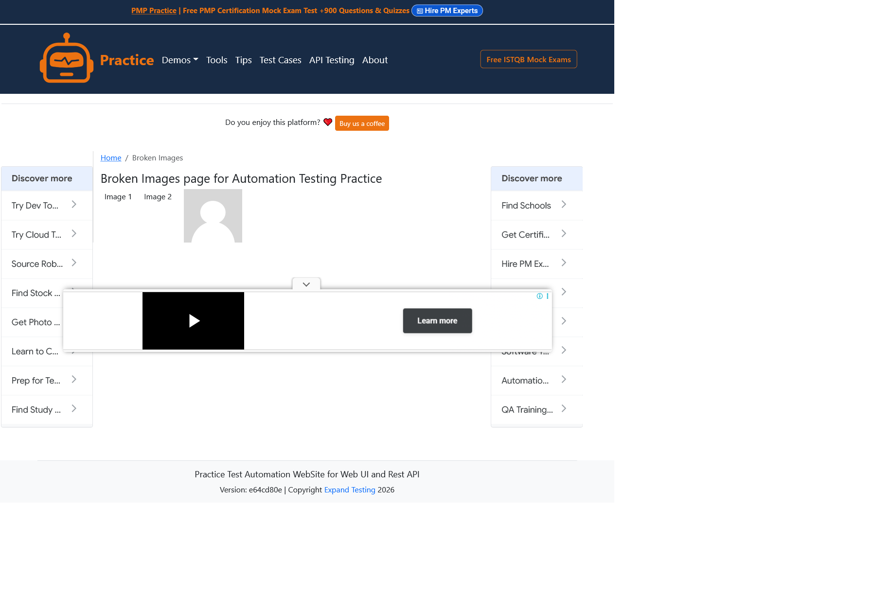
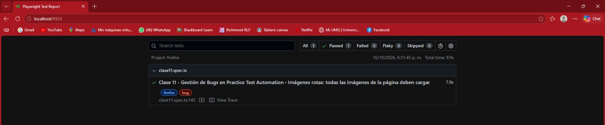
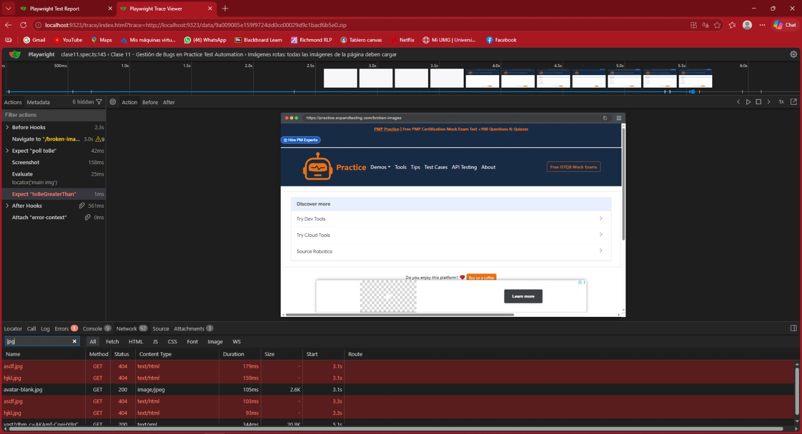

## Descripción
Al abrir la página /broken-images, 2 de las 3 imágenes no se muestran porque su
archivo responde con error 404. Solo avatar-blank.jpg carga correctamente.
Nota: la página es un ejemplo de práctica creado para tener imágenes rotas; se
reporta con fines del laboratorio.

## Severidad: Media
Una parte del contenido visual no se muestra, pero el resto de la página sigue
funcionando y no se pierde información ni datos.

## Prioridad: P3
Molesta, pero el producto puede salir así. Se corrige en el próximo sprint.

## Frecuencia: Siempre
Ocurre en cada carga de la página (reproducido en todas las ejecuciones del test).

## Pasos para reproducir
1. Abrir https://practice.expandtesting.com/broken-images
2. Esperar a que la página termine de cargar
3. Observar las 3 imágenes del contenido

## Resultado esperado
Las 3 imágenes cargan y su ancho natural es mayor que 0.

## Resultado obtenido
asdf.jpg y hjkl.jpg responden 404 y se muestran rotas (ancho natural 0).
avatar-blank.jpg carga correctamente.
El test falla con: Expected: > 0, Received: 0.

## Evidencia
- Captura de la página: 
- Reporte HTML con el error: 
- Traza (pestaña Network) con los 404: 
- Test: `tests/clase11.spec.ts` ("Imágenes rotas", tag @bug)